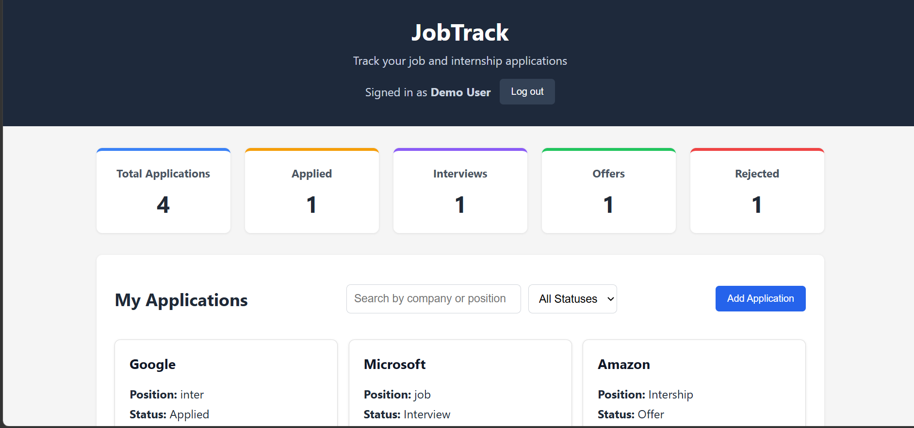
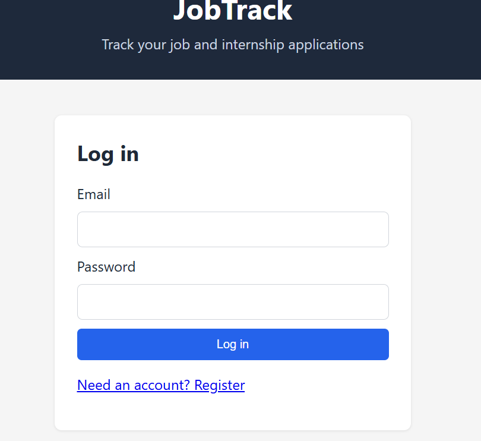
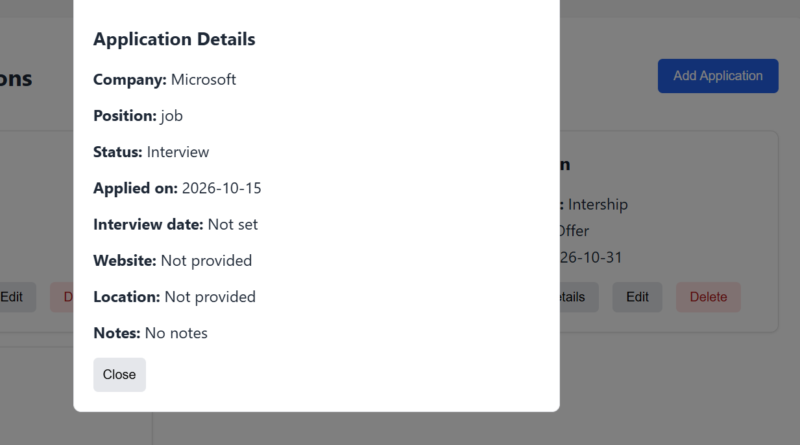

# JobTrack


**Live demo:** https://jobtrack-t2oc.onrender.com
> The app runs on free hosting, so the first visit after a quiet period can take about a minute while the server wakes up.

A full-stack web app for tracking job and internship applications. Create an account, log your applications, follow their status, and see your progress on a dashboard.



## Features

- Register, log in and log out (passwords are hashed, sessions use JWT)
- Add, edit, delete and view applications
- Track status: Applied, Interview, Offer or Rejected
- Search by company or position and filter by status
- Dashboard with live counts for each status
- Notes, interview date, company website and location for every application
- Every user sees only their own data

## Screenshots





## Tech stack

| Area | Technology |
|---|---|
| Frontend | HTML, CSS, vanilla JavaScript |
| Backend | Node.js, Express |
| Database | PostgreSQL |
| Authentication | bcryptjs, JSON Web Tokens |
| Testing | Jest, Supertest, Playwright |
| CI | GitHub Actions |

## Getting started

You need Node.js 20 or newer, PostgreSQL and Git.

```bash
git clone https://github.com/Solomon-Mb/jobtrack.git
cd jobtrack/backend
npm install
```

Create the environment file and fill in your database password and a long random secret:

```bash
# Windows
copy .env.example .env
# macOS / Linux
cp .env.example .env
```

Create the database and its tables, then start the API:

```bash
psql -U postgres -c "CREATE DATABASE jobtrack;"
npm run db:init
npm run dev
```

The API runs on `http://localhost:5000`. Open `frontend/index.html` in your browser to use the app.

## Environment variables

| Variable | Purpose |
|---|---|
| `PORT` | API port (default 5000) |
| `DB_HOST`, `DB_PORT` | PostgreSQL host and port |
| `DB_NAME`, `DB_USER`, `DB_PASSWORD` | Database name and credentials |
| `JWT_SECRET` | Secret used to sign login tokens |
| `JWT_EXPIRES_IN` | Token lifetime, for example `7d` |
| `DATABASE_URL` | Full connection string for a hosted database (used instead of the `DB_*` variables) |
| `NODE_ENV` | Set to `production` on the host (turns CORS off, because the app is same-origin) |
| `TRUST_PROXY_HOPS` | How many proxies sit in front of the app, so rate limiting sees each visitor (3 on Render) |
| `AUTH_RATE_LIMIT_MAX` | Login and register attempts allowed per 15 minutes per visitor (default 20) |

## API reference

All responses are JSON. Errors look like `{ "error": "message" }`.

### Authentication

| Method | Route | Description |
|---|---|---|
| POST | `/api/auth/register` | Create an account (`name`, `email`, `password`) |
| POST | `/api/auth/login` | Log in, returns a `token` and the `user` |
| GET | `/api/auth/me` | Current user (requires a token) |

### Applications

Send the token as `Authorization: Bearer <token>`.

| Method | Route | Description |
|---|---|---|
| GET | `/api/applications` | List your applications |
| GET | `/api/applications/:id` | Get one application |
| POST | `/api/applications` | Create an application |
| PUT | `/api/applications/:id` | Update an application |
| DELETE | `/api/applications/:id` | Delete an application |

Example body for POST and PUT:

```json
{
  "company": "Google",
  "position": "Software Intern",
  "status": "Applied",
  "date": "2026-10-11",
  "interviewDate": "2026-10-20",
  "website": "https://careers.google.com",
  "location": "Remote",
  "notes": "Referred by a friend"
}
```

`status` is one of `Applied`, `Interview`, `Offer`, `Rejected`. Dates use `YYYY-MM-DD`. `interviewDate`, `website`, `location` and `notes` are optional.

## Project structure

```
jobtrack/
|-- .github/workflows/ci.yml   CI pipeline
|-- backend/
|   |-- config/                database connection
|   |-- controllers/           request handling
|   |-- db/                    schema.sql and the init script
|   |-- middleware/            auth and error handling
|   |-- models/                SQL queries
|   |-- routes/                URL routes
|   |-- tests/                 Jest and Supertest tests
|   |-- app.js                 Express app
|   `-- server.js              starts the server
|-- e2e/                       Playwright browser tests
|-- frontend/                  HTML, CSS and JavaScript
`-- docs/screenshots/
```

## Running the tests

Backend tests use a separate database, so your real data is never touched:

```bash
psql -U postgres -c "CREATE DATABASE jobtrack_test;"
cd backend
npm test
```

Browser tests start their own backend on port 5000, so stop `npm run dev` first:

```bash
cd e2e
npm install
npx playwright install chromium
npm test
```

## Security

- Passwords are hashed with bcrypt and never returned by the API
- All SQL uses parameterized queries
- Applications are scoped to the logged-in user
- User text is escaped before it is rendered
- Login errors do not reveal whether an email is registered
- Login and registration are rate limited, and responses carry security headers (helmet)

## Git workflow

`main` holds tested releases and `develop` collects finished work. Each change is made on a feature branch, opened as a pull request into `develop`, and checked by CI before merging.
## Deployment

The app runs on Render (one web service that serves both the API and the frontend) with a Neon PostgreSQL database. Render deploys automatically when `main` changes. Environment variables are set in the Render dashboard: `DATABASE_URL`, `JWT_SECRET`, `JWT_EXPIRES_IN`, `NODE_ENV`, `NODE_VERSION` and `TRUST_PROXY_HOPS`.
